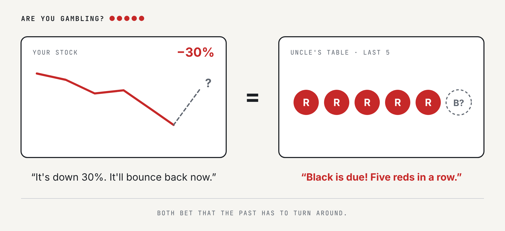
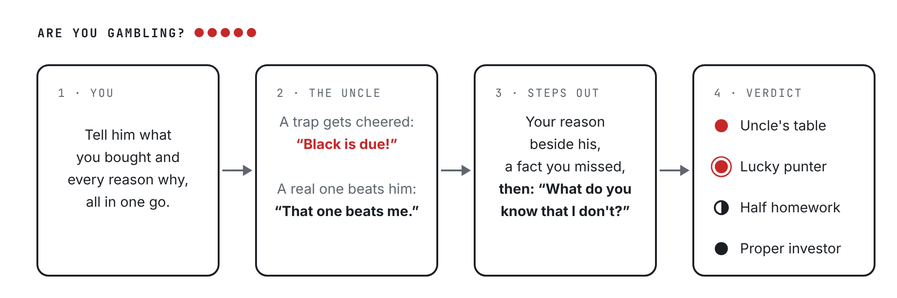

<p align="center">
  <picture>
    <source media="(prefers-color-scheme: dark)" srcset="docs/images/banner-dark.png">
    
  </picture>
</p>

<p align="center"><strong>If your reason isn't better than the uncle's red or black, you're gambling, not investing.</strong></p>

<p align="center">
  <a href="#install">Install</a> · <a href="#how-it-works">How it works</a> · <a href="#try-it">Try it</a>
</p>

<p align="center">
  
  
</p>

A Claude skill that tests your reason for buying a stock or coin. Tell it why you bought. Your neighbour uncle, who loves a flutter, will cheer you on if your reason sounds like his. That's the problem.

<picture>
  <source media="(prefers-color-scheme: dark)" srcset="docs/images/mirror-dark.png">
  
</picture>

> **You:** I bought a stock that's down 30%. It'll bounce back now.
>
> **Uncle:** Down 30%, so it's due to come back? **Black is due!** Five reds in a row at my table, and I put the lot on black, mate.
>
> **Uncle:** Hang on, mate, you sound just like me.
>
> **Verdict: Uncle's table.** The buy rests on the price drop alone, with no reason about the company itself.

<p><sub>Trimmed from a real test run. The full reply also checks a fact about how often big drops come back, and asks what you know about the company that the uncle doesn't.</sub></p>

## How it works

<picture>
  <source media="(prefers-color-scheme: dark)" srcset="docs/images/how-it-works-dark.png">
  
</picture>

It judges the thinking behind a reason, not its wording. A finance word doesn't make a reason real, and plain words don't make it weak. Ten common traps are in [`traps.md`](skills/are-you-gambling/references/traps.md), from the gambler's fallacy to loss chasing.

| Verdict | When you get it |
| --- | --- |
| **Uncle's table** | Your decision rests on a trap. |
| **Lucky punter** | It rests on a trap, and the trade has already made money. |
| **Half homework** | A real reason, but no plan yet: what you pay, how much, how long, when you'd get out. |
| **Proper investor** | A real reason and a plan you'd act on, including when you'd get out. |

## Install

It's a Claude plugin. Added in the Claude app, it follows your account into chat, Cowork and Claude Code.

**Claude app** (web or desktop):

1. Download `are-you-gambling.plugin` from the [latest release](https://github.com/chayapol-p/are-you-gambling/releases/latest).
2. Open **Customize → Plugins** and upload the file.

**Claude Code:**

```bash
claude plugin marketplace add chayapol-p/are-you-gambling
claude plugin install are-you-gambling@are-you-gambling
```

`claude plugin update are-you-gambling` gets new versions.

## Try it

In any Claude chat, type:

```text
Are You Gambling? I bought <asset> because <your reason>.
```

The uncle introduces himself and cheers every reason you gave. If you gave only one, he asks for more first. Then he steps out of character and gives your verdict.

## Not financial advice

This is a thinking check. It never tells you to buy or sell.

## Privacy

The plugin is instructions for Claude, nothing else. It runs no code, has no server and sends your words nowhere. To check a fact in your reason, Claude may search the web with its own search tool, the same as in any chat.

## Tell us how it went

Got a verdict, or think the uncle got it wrong? [Open an issue](https://github.com/chayapol-p/are-you-gambling/issues/new/choose); there's a short form for each.

## Licence

[MIT](LICENSE), by chayapol.par
